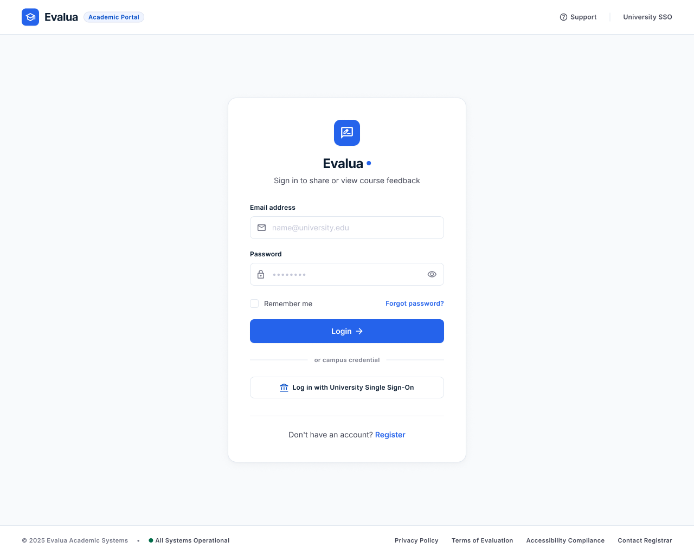

# Course Feedback

A web app where students rate lectures anonymously and teachers see the aggregated results.

Internet Programming I, ITC 2026-2027. Individual project.

## Features

**Student**
- Register and log in
- Browse and search the list of lectures
- Rate a lecture (1-5 stars) with a comment, once per lecture
- Feedback is anonymous

**Teacher**
- Register and log in
- Create, edit, and delete their own lectures
- See the average rating, the star distribution, and anonymous comments

> Status: frontend setup done. Backend and features are in progress.

## Tech stack

- Frontend: Vue 3, TypeScript, Vite, Vue Router, Pinia, Vitest
- Backend: NestJS, Prisma, PostgreSQL (planned)
- Tests: Vitest (components), Jest + Supertest (API)

## Project structure

```
course-feedback/
  README.md
  AI_LOG.md
  DECISIONS.md
  CHECK.md
  docs/
    SPEC.md
    wireframes/
  frontend/     Vue 3 + Vite + TypeScript
  backend/      NestJS + Prisma
  .github/workflows/
```

## Requirements

- Node.js 20 or newer
- PostgreSQL 15 or newer (needed once the backend is added)

## How to run

### Frontend

```bash
cd frontend
npm install
npm run dev
```

Open http://localhost:5173

### Backend (coming soon)

```bash
cd backend
npm install
cp .env.example .env      # set DATABASE_URL and JWT_SECRET
npx prisma migrate dev
npm run start:dev
```

### Tests

```bash
cd frontend
npm run test:unit
```

## Screenshots

Wireframes are in `docs/wireframes/`.

## Documentation

- [SPEC.md](docs/SPEC.md): user stories and acceptance criteria
- [DECISIONS.md](DECISIONS.md): design choices
- [AI_LOG.md](AI_LOG.md): how AI was used
